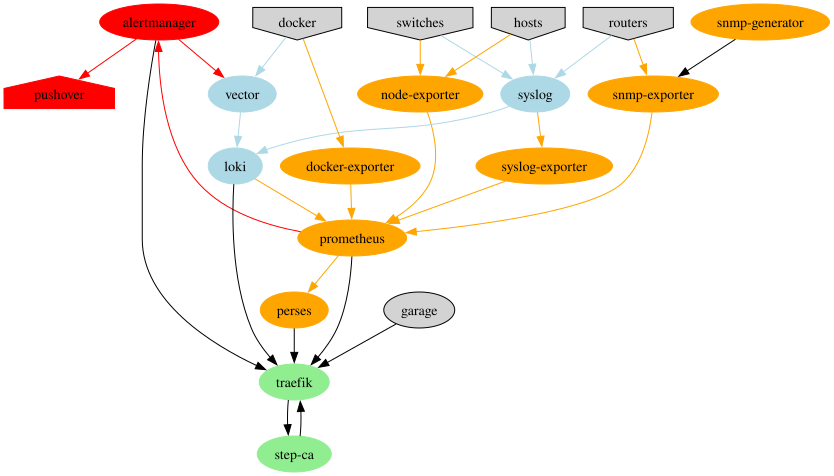

# House logging and monitoring configuration

## Certificate authority and web frontend

- `traefik`
- `step-ca`

## Logging

- `loki`
- `syslog`

  We use [axosyslog](https://axoflow.com/docs/axosyslog-core/) (effectively "modern syslog-ng", or "syslog-ng-ng") to receive syslog message from devices (switches, routers) and feed them to loki.

- `vector`

  Vector is a router for logs and metrics. In this configuration, we use it to:

  1. Collect container logs and forward them to loki.
  2. Receive alerts from alertmanager and send those to loki.

## Metrics and alerting

- `alertmanager`
- `docker-exporter`

  [docker-exporter](https://github.com/davidborzek/docker-exporter) reads container metrics from Docker and presents them in a prometheus-compatible format.

- `node-exporter`
- `perses`
- `prometheus`
- `snmp-exporter`
  [snmp-exporter](https://github.com/prometheus/snmp_exporter), using a configuration generated with
  [snmp-generator](https://github.com/prometheus/snmp_exporter/blob/main/generator/README.md),
  polls SNMP-enabled devices for metrics and presents them in a
  prometheus-compatible format.

## Other services

- `garage`

  [Garage](https://garagehq.deuxfleurs.fr/) provides an S3 object storage
  interface to the DiskStation. The S3 API is used as a backup target by other
  devices in the house.
